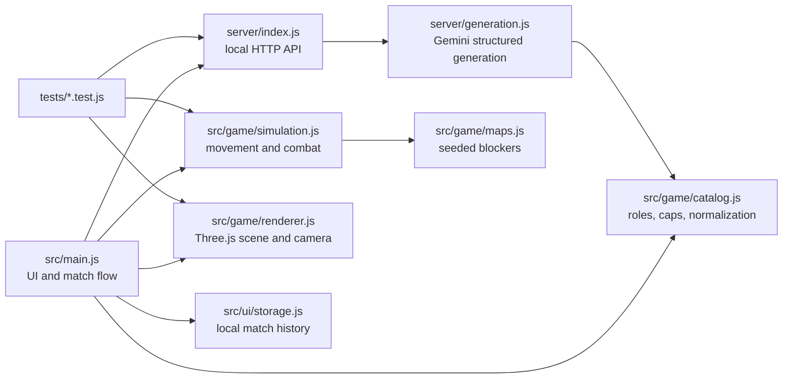

# Battlegrounds — AI Battle Simulator

# The original Author/Programmer: ShauryaTanwar

A 3D, same-device, two-player army sandbox built from [SPEC.md](SPEC.md). Describe improbable armies, draft a balanced force, and watch autonomous units clash on a floating battlefield. Includes a complete offline mode and optional Gemini-powered generation through Google's Gemini API.

## Run it

Install **Node.js 24.15+ (24.x)** or **22.22.2+ (22.x)**, then open a terminal in this project folder. Node 26+ is also accepted by the dependency set:

```powershell
npm install
npm run dev
```

Open **http://127.0.0.1:3000** in a current desktop browser with WebGL and hardware acceleration. Keep the terminal running. Press Ctrl+C in that terminal to stop the server. On Windows, if PowerShell blocks `npm.ps1`, use `npm.cmd install` and `npm.cmd run dev` instead.

No API key is required to play. Choose **Watch a demo** to immediately launch two example armies, or **Create a battle** to take turns drafting on the same device.

For a production build served by the same local API server:

```powershell
npm run build
npm start
```

This is a **local prototype**, not a public multiplayer service. The default server binds to `127.0.0.1`. Nothing is deployed or published by these commands.

## Connect Gemini generation

```powershell
Copy-Item .env.example .env
```

Create a Gemini API key in [Google AI Studio](https://aistudio.google.com/app/apikey), then edit `.env` yourself and set `GEMINI_API_KEY`. The optional `GEMINI_MODEL` defaults to `gemini-3.5-flash-lite`. Restart the server after changing `.env`, then refresh the browser. The top-right badge changes to **Gemini connected** when a nonempty key is configured. This badge reports configuration, not a verified successful request.

Google currently lists a free tier for the default model, subject to account, region, quota, and future pricing changes. Players do not download a model: the Node server calls Gemini remotely. Each person running their own copy supplies their own key, while a future hosted version could use one server-managed key with authentication and rate limits. The key never enters browser code. See [docs/AI_INTEGRATION.md](docs/AI_INTEGRATION.md) for request shape, failure behavior, and privacy.

## Play

1. Choose one of three battlefield themes. Each new battle gets a new layout seed.
2. Commander One names an army, describes its composition, and clicks **Forge army** (or **Generate with Gemini**). Ready-made reinforcements can also be added one at a time.
3. Review the roster and power meter. Generation **replaces** the current roster. Adding reinforcements appends units. Removing a troop removes one unit from a group.
4. Lock the army, pass the device, and let Commander Two create an army. The first army's meshes and roster are hidden from the second draft.
5. After a three-second countdown, both armies move, target, attack, heal, and die automatically. Control the camera, inspect individual units, pause, or change battle speed.
6. The last team with survivors wins. Both forces dying in the same tick is a draw. Results reveal both prompt histories and rosters. Rematch uses the same armies and a new seed; **New armies** restarts drafting.

Both commanders get a two-minute **active drafting** timer. Generation, dialogs, and a hidden browser tab pause it. You can disable the timer during drafting. On timeout, a nonempty army locks automatically; an empty roster receives a default balanced army.

## Camera and playback

- Left drag: orbit. Right drag: pan. Scroll: zoom.
- W/A/S/D: move freely across the battlefield. Q/E: descend/ascend. Shift: move faster.
- Click a unit: inspect. F: follow the selected unit, or select and follow the first survivor.
- Tab: select the next living unit. Escape: release follow and selection, or close the open dialog.
- O or **Overview**: reset the camera. Space: pause/resume.
- Playback buttons: 0.5×, 1×, 2×, or 4×. Playback speed changes simulation time, not role balance.
- The **Field guide** explains controls and all troop abilities in the game.

Following is an orbitable third-person camera that moves with the unit. It is not a first-person unit view. Camera movement is available during battle even when paused.

## What is implemented

- A full local pass-and-play loop: main menu, timed drafts, private handoff, countdown, battle, result, prompt reveal, and rematch.
- Eight fixed-stat roles, five procedural visual forms, six cosmetic elements, per-unit health and death, melee/ranged attacks, area damage, armor, and allied healing.
- Seeded maps with three themes, circular collision blockers, movement steering, unit separation, a floating arena, shadows, effects, and health bars.
- Free camera controls, click selection, unit follow, live unit inspector, battle feed, pause, and four playback speeds.
- Optional Gemini structured generation, a deterministic offline keyword parser, and server-side power enforcement shared with the client.
- Troop presets, army suggestions, and the last 20 match results in browser-local history.
- Small optional synthesized sound cues, keyboard shortcuts, dialog focus trapping, text escaping, and responsive layouts.

## Important limitations

The prototype approximates unusual prompts with eight supported roles. Character names, elements, and forms reflect ideas, but it does not generate arbitrary models, scripts, custom powers, aerial movement, or realistic physics. Elements are cosmetic. Offline generation uses documented keywords rather than language understanding.

The deterministic point cap prevents invalid stats and overspending; it is not a proof that every composition is competitively balanced. Movement uses steering and circle collisions rather than a navigation mesh or rigid-body engine. After 120 simulated battle seconds, healing shuts off and escalating damage forces stalemates to end.

The match history is local to one browser profile and can be lost when browser data is cleared. Drafts are not saved across a page reload. Pass-and-play hides information in the normal interface; someone inspecting JavaScript memory or developer tools can see both teams.

Three.js and Vite are installed locally. Optional Google Fonts load at runtime; system fonts are used when unavailable. The core offline game does not require an AI provider connection once dependencies are installed.

## Acceptance status

The eight acceptance criteria in [SPEC.md](SPEC.md) are implemented. The latest verification passed 27 automated tests and a production build. A desktop-browser walkthrough verified the 3D menu, local two-player handoff, prompt generation, automatic battle, unit selection/following, results, and prompt reveal. A live Gemini request also produced a legal four-unit, 430-power army. The server, rather than the model, makes the final deterministic power-cap decision.

| SPEC criterion                  | Evidence                                                                             |
| ------------------------------- | ------------------------------------------------------------------------------------ |
| Same-device multiplayer         | Separate Commander One/Two drafts with a hidden handoff                              |
| Consistent LLM generation       | Structured Gemini output plus server-side role, 1,000-power, and 32-unit enforcement |
| Enemy targeting and interaction | Deterministic targeting, movement, separation, attacks, splash, armor, and healing   |
| Health and death                | Per-unit HP, defeat events, visual removal, and survivor counts                      |
| Prompt fidelity                 | Names, counts, supported roles, forms, and cosmetic elements reflect the prompt      |
| Free-roaming camera             | Orbit/pan/zoom, WASD/QE flight, overview, and pause-safe camera movement             |
| Unit spectating                 | Click/Tab selection and third-person follow mode                                     |
| Win condition                   | Winner or simultaneous-defeat draw, followed by roster and prompt reveal             |

Remaining acceptance work is device-specific visual QA: exercise all pointer gestures, three map themes, narrow layouts, and graphics performance on the final presentation computer. Competitive role costs are deterministic but still need empirical tuning across many seeds.

## Code map



For the next maintainer: keep numeric stats and caps in `catalog.js`, mechanics in `simulation.js`, visuals in `renderer.js`, and provider credentials on the server. Read [AGENTS.md](AGENTS.md) and [docs/HANDOFF.md](docs/HANDOFF.md) before changing scope.

## Verify

```powershell
npm test
npm run check
npm run build
```

See [docs/TESTING.md](docs/TESTING.md) for the manual acceptance checklist, verification evidence, and browser-testing limitation of the initial implementation.

## Documentation map

- [AGENTS.md](AGENTS.md): start here when continuing development as an agent.
- [docs/ARCHITECTURE.md](docs/ARCHITECTURE.md): file tree, responsibilities, data contracts, state flow, and extension points.
- [docs/GAME_SYSTEMS.md](docs/GAME_SYSTEMS.md): combat, movement, determinism, balance, map, rendering, and camera details.
- [docs/AI_INTEGRATION.md](docs/AI_INTEGRATION.md): Gemini setup, schemas, validation, endpoints, error behavior, and privacy.
- [docs/TESTING.md](docs/TESTING.md): automated tests and manual acceptance checks.
- [docs/HANDOFF.md](docs/HANDOFF.md): current state, deliberate tradeoffs, known issues, and next priorities.
- [docs/DEVELOPMENT.md](docs/DEVELOPMENT.md): installation, commands, troubleshooting, and implementation recipes.
- [SPEC.md](SPEC.md): the original proposal, preserved without edits.
